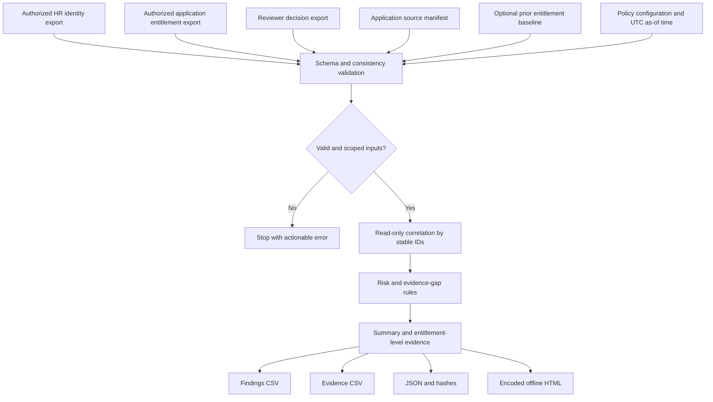

# Design and data flow

## Layers

1. **Input**: Five fixed-schema CSV types and JSON configuration; prior baseline optional.
2. **Validation**: required column checks, unique key requirements, status/date enumeration, UTC and as-of checks, review cycle binding and no dangling decision references. Validation failure stops before report generation.
3. **Correlation**: case-insensitive stable ID dictionaries, not person display name; includes HR identity state and application-source quality.
4. **Evaluation**: deterministic rule findings with unique IDs, severity, category, record references, text description and recommended investigation.
5. **Evidence output**: summary, entitlements with decision states, source-evidence flags, source hash checksums and no source-path disclosure.

## Important semantics

- `SourceEvidenceCurrentAndComplete=True` means *the supplied* manifest declares a recognized application, sufficient freshness, and completeness. This is not an independent assertion that the application export is actually complete.
- `ReviewEvidenceState=Recorded` means required decision and source-evidence checks passed in the **provided inputs**. It is not an audit sign-off or certification.
- `Decision=Approve` is a raw claim; only source-of-truth confirmation can establish reviewer authorization.
- `Decision=Revoke` with `AccessStatus=Active` is a discrepancy requiring investigation; no access is changed.
- An entitlement missing from a baseline is a **change indicator**, not evidence of excess privilege.

## Future adapters

Keep adapters separate from core evaluation. Approved source systems such as SailPoint, ServiceNow, and app-native exports can be mapped to the fixed schemas after their export semantics, freshness, ID stability, and authorization are validated. No third-party integration is shipped.
